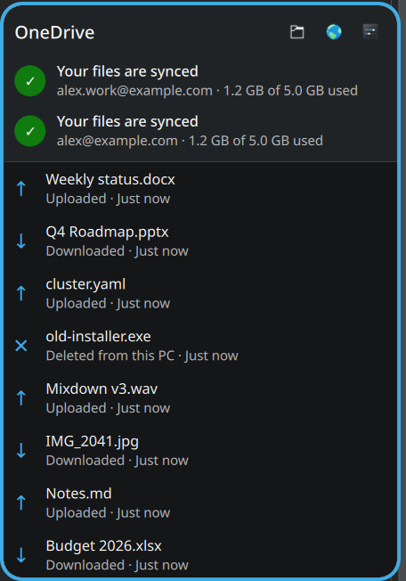
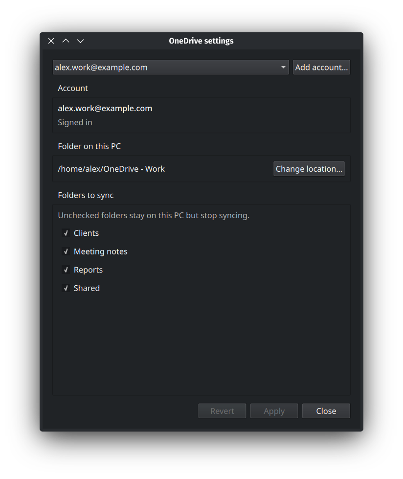

# OneDrive GUI

Windows-style tray + activity flyout for [abraunegg/onedrive](https://github.com/abraunegg/onedrive).

 

- `daemon/` (Rust): runs one `onedrive --monitor --confdir <account>` per authorised account, parses its output, serves status on D-Bus (`org.onedrivegui.Daemon`).
- `app/` (C++/Qt6/QML): tray icon, flyout, settings and notifications; talks only to the daemon.
  `onedrive-gui --settings` opens Settings (in the running instance if there is one).
- `dolphin/` (optional, KDE): sync marks on files in Dolphin, from the daemon's state.

## Safety

The GUI never touches synced files or the onedrive database. The daemon only ever runs onedrive as
`--monitor --confdir`, `--confdir --display-quota` (read-only, before each start), `--resync --resync-auth`
once after a settings change, and `--reauth --auth-files` to sign in. It stops onedrive with SIGTERM only
(no SIGKILL), so onedrive exits cleanly. After a crash it restarts onedrive with a growing delay (10 s up to 5 min).
Its systemd unit conflicts with `onedrive.service` so two instances never sync the same account.
Note: `onedrive@.service` template instances are not covered; don't run them alongside.

## Build

```sh
cargo build --release --manifest-path daemon/Cargo.toml
cmake -S app -B app/build -G Ninja -DCMAKE_BUILD_TYPE=Release && cmake --build app/build
```

## Test

```sh
tests/run.sh            # everything below in one go (or `just test`)
cargo test --manifest-path daemon/Cargo.toml
daemon/tests/smoke.sh   # real daemon on a private D-Bus with a fake onedrive; no real account involved
dolphin/tests/check.sh  # overlay plugin against the same setup
```

## Install

```sh
./install.sh              # Arch: builds and installs the pacman package (with the Dolphin plugin)
./install.sh --user       # any distro: into ~/.local (no Dolphin plugin)
./install.sh --uninstall  # remove it (account data and synced files are never touched)
```

It checks for `onedrive` (offers the AUR `onedrive-abraunegg` on Arch), installs build dependencies,
removes stale `~/.local` copies that would shadow the package, then enables the daemon and starts the tray app.
`--no-start` skips that; `--yes` skips questions.

Accounts live in `~/.config/onedrive` or `~/.config/onedrive/accounts/<name>/`; add accounts and sign in from Settings.
Don't run `onedrive.service` or `onedrive@.service` alongside the daemon.

## Settings changes

Changing the sync folder or excluded folders stops onedrive, rewrites its `config` (previous copy kept as
`config.onedrive-gui.bak`), and restarts it once with `--resync`, which onedrive requires after such changes.
A resync deletes nothing on either side; differing files are kept as both copies. Excluded folders stay on
disk. A new sync folder must be empty; the old one is left as is.

## Dolphin marks

onedrive locks its database while running, so per-file state isn't readable. Files show a check mark when
their account is fully synced, a warning on conflict copies (`-safeBackup-`), an error if their last transfer
failed, and nothing if excluded or matched by onedrive's default `skip_file`. Custom `skip_file`/`skip_dir`
patterns aren't applied to the marks.

## License

MIT or Apache-2.0, at your option ([LICENSE-MIT](LICENSE-MIT), [LICENSE-APACHE](LICENSE-APACHE)).

Releases: tag `vX.Y.Z` (matching `daemon/Cargo.toml` and the PKGBUILD); CI builds the Arch package and publishes it.
